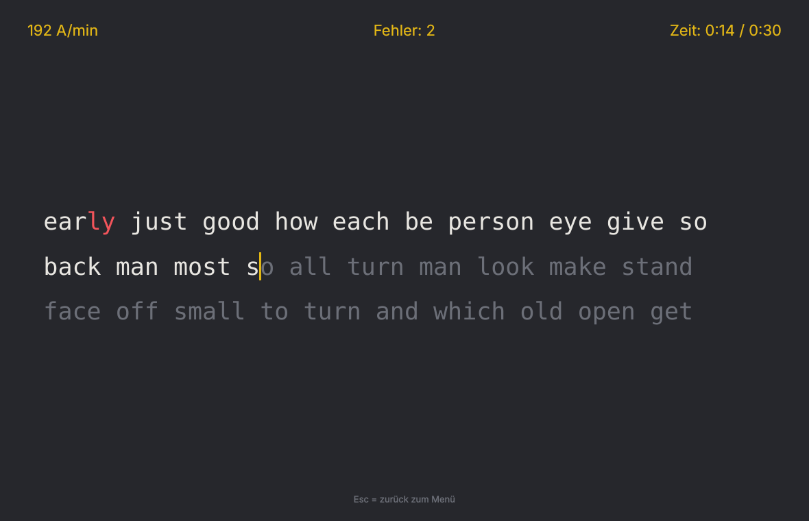
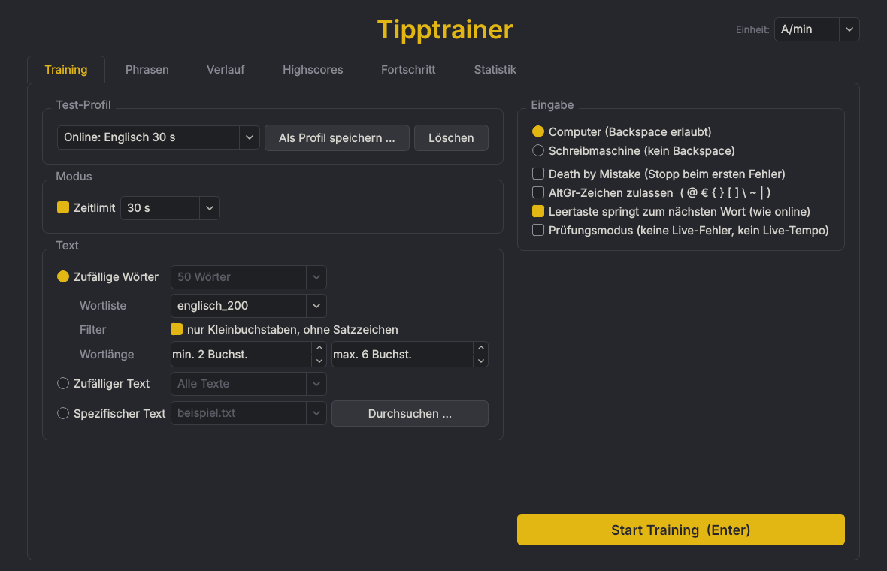
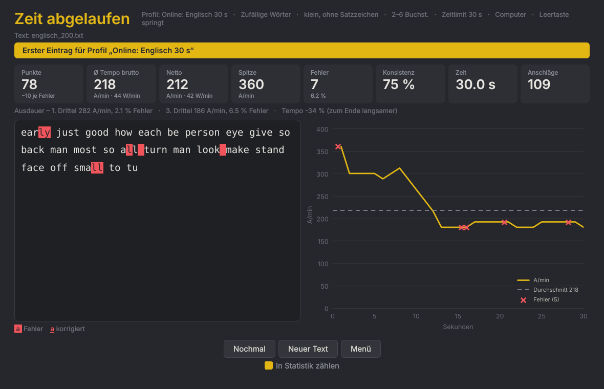
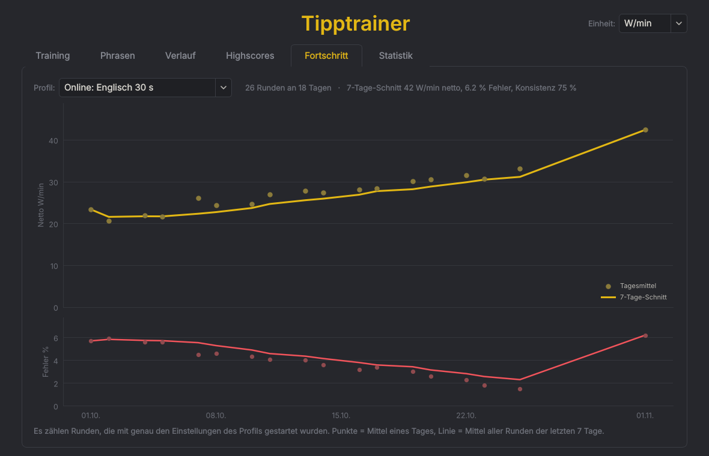

# Tipptrainer

Ein Desktop-Programm zum Üben des 10-Finger-Systems, geschrieben in Python mit PySide6 (Qt).
Die Oberfläche ist deutsch, geübt werden kann mit deutschen und englischen Texten und Wörtern.



## Funktionen

- **Drei Textquellen:** zufällige Wörter aus einer Wortliste, ein zufälliger Text aus einer Gruppe, ein bestimmter Text.
- **Phrasen-Modus:** eigene Zeilen (Wörter, Buchstabenfolgen, Sätze) werden in Schleife geübt, mit Auswertung je Phrase und speicherbaren Presets. Mitgelieferte Vorlagen: die häufigsten Bigramme (Buchstabenpaare) und schwierige Wörter, jeweils Deutsch und Englisch.
- **Feststelltasten-Hinweis:** Tippen Sie Großbuchstaben ohne Shift, erscheint „FESTSTELLTASTE AKTIV“.
- **Live-Anzeige:** Tempo in Anschlägen pro Minute (A/min) oder Wörtern pro Minute (W/min = A/min / 5), Fehler und Zeit.
- **Eingabemodi:** Computer (Backspace erlaubt, korrigierte Fehler zählen weiter mit) oder Schreibmaschine (kein Backspace).
- **Zeitlimit** (15 s bis 10 min oder frei) oder Text bis zum Ende tippen.
- **Tempo-Cursor:** ein zweiter, grauer Cursor läuft mit einem Zieltempo (z. B. 100 W/min) durch den Text. Liegt er vor Ihrem Cursor, sind Sie langsamer als das Ziel.
- **Death by Mistake:** Die Runde endet beim ersten Fehler, die Leertaste startet denselben Text neu.
- **Prüfungsmodus:** Während der Runde keine Fehlermarkierung und kein Tempo, nur die Zeit.
- **Online-Stil:** Nur Kleinbuchstaben ohne Satzzeichen, Wortlänge einstellbar, Leertaste springt zum nächsten Wort.
- **Test-Profile:** feste Einstellungen mit einem Klick, jeweils mit eigener Bestenliste. Mitgeliefert für Deutsch und Englisch: Online 15/30/60 s und Textprüfung 5/10 min.
- **Auswertung:** Punkte, Brutto- und Netto-Tempo, Spitze, Fehler und Fehlerquote, Konsistenz, Ausdauer (erstes gegen letztes Drittel), Text mit rot markierten Fehlern und Tempo-Verlauf als Grafik.
- **Highscores** je Text und je Profil, mit Rekord-Hinweis.
- **Fortschritt:** Tageswerte und 7-Tage-Schnitt je Profil.
- **Statistik:** Problemzeichen (Groß- und Kleinschreibung getrennt), Verwechslungen, Problemwörter und eine Tastatur-Heatmap. Ausgewählte Problemstellen lassen sich direkt als Phrasen-Preset speichern.
- **Einstellungen:** Design Dunkel oder Hell, Schriftgröße des Tipptexts und der Oberfläche, Tempo-Cursor.
- **Verlauf:** die letzten Runden mit vollständiger Auswertung; einzelne Runden lassen sich mit ★ dauerhaft speichern.

| Training | Auswertung | Fortschritt |
|---|---|---|
|  |  |  |

## Installation

Voraussetzung: Python 3.10 oder neuer.

```bash
git clone https://github.com/Drumlusar/TippTrainer.git
cd TippTrainer
python3 -m venv .venv
source .venv/bin/activate        # Windows: .venv\Scripts\activate
pip install -r requirements.txt
```

## Starten

```bash
source .venv/bin/activate        # falls noch nicht aktiv
python main.py
```

## Tests

```bash
python -m pytest
```

## Eigene Texte und Wortlisten

- **Texte:** `.txt`-Dateien direkt in `daten/texte/` ablegen. Unterordner werden nicht gelesen. Die Gruppe eines Textes ist sein Dateiname bis zum letzten „_“. Aus `lang_de_stadtpark.txt` wird die Gruppe `lang_de`. Bei „Zufälliger Text“ lässt sich eine Gruppe auswählen.
- **Phrasen-Vorlagen:** Jede `.txt`-Datei in `daten/phrasen_vorlagen/` erscheint im Reiter Phrasen als Vorlage (eine Phrase pro Zeile, `#` = Kommentar).
- **Wortlisten:** Jede `.txt`-Datei in `daten/wortlisten/` ist eine eigene Liste mit einem Wort pro Zeile. Zeilen mit `#` werden ignoriert.
- Sonderzeichen werden beim Laden vereinheitlicht, z. B. typografische Anführungszeichen und Gedankenstriche. So prüfen Sie, wie ein Text danach aussieht (`↵` = Enter):

  ```bash
  python -m core.text_normalizer daten/texte/beispiel.txt
  ```

Selbst hinzugefügte Texte sind über `.gitignore` von der Versionsverwaltung ausgenommen. Nur die mitgelieferten Übungstexte gehören zum Repository.

## Gespeicherte Daten

Alles bleibt lokal im Ordner `daten/` und ist nicht Teil des Repositorys:

| Datei | Inhalt |
|---|---|
| `verlauf/sessions.csv` | Kennzahlen aller Runden (Excel-tauglich: Semikolon, Dezimalkomma) |
| `verlauf/runs/*.json` | vollständige Auswertung der letzten 20 Runden, der mit ★ markierten und der Top 10 je Text bzw. Profil |
| `verlauf/statistik.json` | Tagessummen für den Reiter Statistik |
| `profile.json` | Test-Profile |
| `phrasen_presets.json` | Phrasen-Presets |
| `einstellungen.json` | Strafe pro Fehler (für die Punkte), Einheit, Design, Schriftgrößen, Tempo-Cursor |

## Aufbau

- `core/`: Tipplogik, Messwerte und Textquellen, ohne Qt und vollständig getestet
- `storage/`: Speicherung (CSV, JSON)
- `ui/`: Oberfläche (PySide6, matplotlib)

Details stehen in [`Architekturplan_Tipptrainer.md`](Architekturplan_Tipptrainer.md).

## Lizenz

[MIT](LICENSE)
